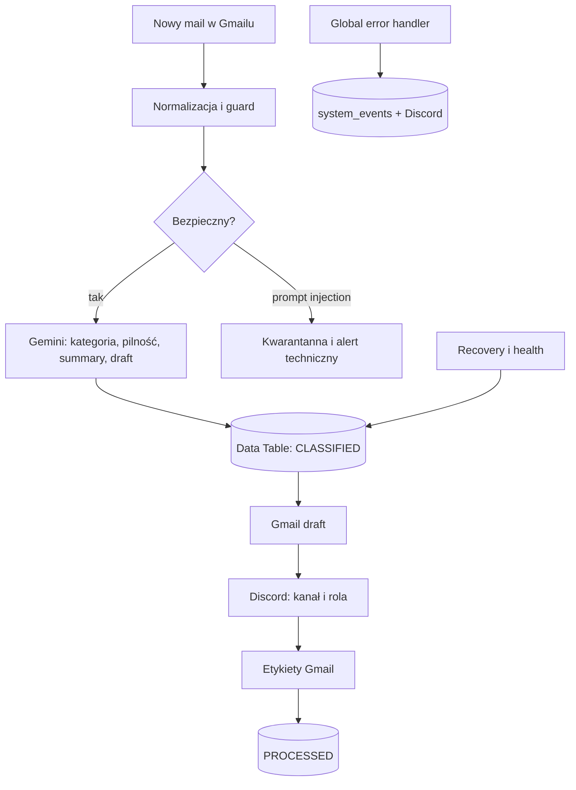
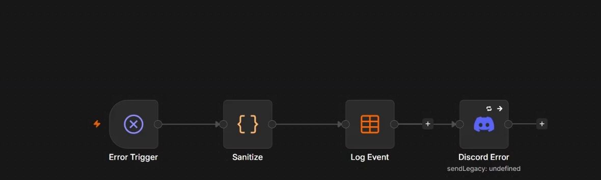
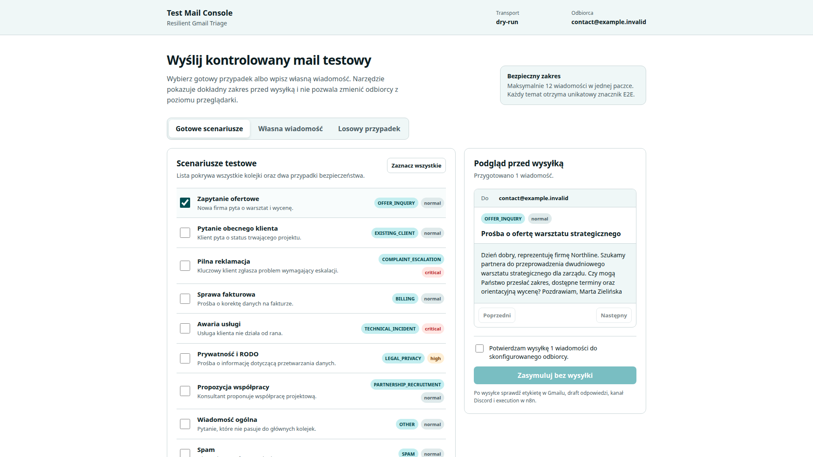

# Automatyczna obsługa skrzynki kontaktowej

**Zadanie rekrutacyjne: Automation Specialist**

**Kandydat:** Olek Senchuk 
**Technologia:** n8n 2.30.7, Gmail, Gemini, Discord 
**Data:** 20 lipca 2026

> Dokumentację przygotowałem przy wsparciu AI (Hermes Agent / model językowy). Architektura, konfiguracja, testy oraz decyzje projektowe zostały zweryfikowane na działającej instancji n8n.

Szczegółowy opis techniczny znajduje się w `DOKUMENTACJA_TECHNICZNA_PL.pdf`. Ten dokument jest krótką wersją przeznaczoną do odbioru rozwiązania.

## 1. Cel biznesowy i zakres

Pięcioosobowy zespół firmy doradczej obsługuje wspólną skrzynkę kontaktową. Wiadomości dotyczą sprzedaży, trwających projektów, reklamacji, płatności i spraw administracyjnych. W ręcznym procesie najwięcej ryzyka pojawia się między otrzymaniem maila a przypisaniem właściciela: pilna sprawa może wyglądać jak zwykłe pytanie, a mniej typowa wiadomość może zostać przeoczona.

Automatyzacja porządkuje ten etap. Nie zastępuje człowieka w komunikacji z klientem. Odczytuje mail, nadaje kategorię i pilność, przygotowuje draft odpowiedzi, wskazuje odpowiedzialną rolę na Discordzie i porządkuje skrzynkę etykietami. Odpowiedź pozostaje draftem w Gmailu i wymaga sprawdzenia przed wysłaniem.

### Co otrzymuje zespół

- uporządkowaną skrzynkę bez otwierania każdej wiadomości;
- krótkie podsumowanie i propozycję odpowiedzi;
- routing do kanału oraz roli odpowiedzialnej za dany typ sprawy;
- wyraźne oznaczenie wiadomości krytycznych;
- widoczny alert, jeśli integracja lub workflow nie działa;
- trwały stan przetwarzania, który pozwala wznowić pracę bez powielania draftów i notyfikacji.

### Granica automatyzacji

System nie usuwa wiadomości i nie wysyła odpowiedzi automatycznie. Spam jest oznaczany i finalizowany bez draftu. Próby prompt injection trafiają do kwarantanny przed wywołaniem modelu. Zwykła notyfikacja Discord zawiera summary i propozycję odpowiedzi, dlatego dostęp do kanałów powinien odpowiadać dostępowi do skrzynki kontaktowej.

Rozwiązanie składa się z pięciu workflow. Cztery obsługują proces produkcyjny. Piąty służy wyłącznie do kontrolowanego testowania globalnego error handlera i poza demonstracją pozostaje wyłączony.

### Zmiana w codziennej pracy

| Moment | Proces ręczny | Po wdrożeniu |
|---|---|---|
| Nowy mail | trzeba otworzyć i przeczytać | widoczna kategoria, pilność i summary |
| Przypisanie | przekazanie „na oko” | kanał i rola zależne od kategorii |
| Odpowiedź | pisana od początku | draft gotowy do review |
| Sprawa krytyczna | zależna od uwagi odbiorcy | etykieta pilna i bezpośrednia rola kryzysowa |
| Awaria integracji | może pozostać niewidoczna | `system_events` i alert techniczny |

## 2. Przepływ i użyte integracje

| Workflow | Odpowiedzialność | Trigger |
|---|---|---|
| 01 Intake and Classify | Gmail, deduplikacja, guard, Gemini, zapis klasyfikacji | Gmail Trigger co minutę lub manualnie |
| 02 Act and Notify | draft, routing Discord, etykiety końcowe | co minutę lub manualnie |
| 03 Recovery and Diagnostics | retry, orphan scan, health i raport | 5/15 minut, raport dzienny |
| 04 Global Error Handler | oczyszczony zapis i alert błędu | Error Trigger |
| 05 Controlled Failure | bezpieczna demonstracja error flow | wyłącznie test kontrolowany |

### Narzędzia

**n8n** odpowiada za orkiestrację i trwałe execution. **Gmail OAuth2** umożliwia pobieranie wiadomości, tworzenie draftów i obsługę etykiet. **Gemini 3.1 Flash Lite** zwraca dane w wymuszonym schemacie JSON przy temperaturze 0. **Discord** rozdziela notyfikacje na siedem kanałów biznesowych. **Data Tables** przechowują stan wiadomości, telemetry zdrowia oraz zdarzenia techniczne.

Workflow 02 wykonuje efekty uboczne w kolejnych tickach: `CLASSIFIED → DRAFT_CREATED → NOTIFIED → PROCESSED`. Checkpointy `draft_created` i `discord_notified` mają pierwszeństwo przed tekstowym statusem. Dzięki temu ponowienie Discorda nie tworzy drugiego draftu.

## 3. Kategorie, routing i tryb pilny

Model rozpoznaje dziewięć kategorii biznesowych. Dziesiąty stan, `PROMPT_INJECTION`, pochodzi z deterministycznej warstwy bezpieczeństwa, a nie z decyzji Gemini.

| Kategoria | Kanał / właściciel | Zachowanie |
|---|---|---|
| `OFFER_INQUIRY` | Sprzedaż | draft i notyfikacja |
| `EXISTING_CLIENT` | Obsługa klienta | draft i notyfikacja |
| `COMPLAINT_ESCALATION` | Incydenty i eskalacje | draft, notyfikacja, możliwa eskalacja |
| `TECHNICAL_INCIDENT` | Incydenty i eskalacje | draft, notyfikacja, możliwa eskalacja |
| `BILLING` | Finanse | draft i notyfikacja |
| `LEGAL_PRIVACY` | Prawo i prywatność | draft i notyfikacja |
| `PARTNERSHIP_RECRUITMENT` | Administracja | draft i notyfikacja |
| `OTHER` | Inne | draft i notyfikacja |
| `SPAM` | bez kanału | etykieta, bez draftu |
| `PROMPT_INJECTION` | alert techniczny | kwarantanna, bez Gemini i draftu |

Przypisanie osób nie jest zapisane na stałe w adresach użytkowników. Workflow wskazuje role Discord, na przykład Sprzedaż, Finanse albo Crisis. Zmiana członka zespołu wymaga zmiany członkostwa w roli, a nie edycji automatyzacji.

Pilność ma trzy poziomy: `normal`, `high` i `critical`. Wiadomość krytyczna otrzymuje etykietę pilną, trafia do właściciela kryzysowego i może oznaczyć rolę backupową. Oprócz decyzji modelu system używa sygnałów deterministycznych, żeby treść maila nie mogła obniżyć oczywistego poziomu alarmu.

## 4. Obsługa błędów i odporność

Proces nie powinien zatrzymać się bez śladu. Globalny error handler odbiera błędy workflow, usuwa z komunikatu adresy URL, tokeny i długie identyfikatory, zapisuje zdarzenie w `system_events` oraz wysyła alert na techniczny kanał Discord. Alert podaje workflow, node i krótki komunikat potrzebny do diagnozy. Nie zawiera surowej treści maila.

Workflow 03 uzupełnia globalny handler. Szuka starych rekordów wymagających retry oraz porównuje ostatnie wiadomości Gmail z Data Table. Jeśli mail istnieje w skrzynce, ale nie ma rekordu stanu, safety scan może ponownie wprowadzić go do procesu.

### Zabezpieczenia

- deduplikacja po Gmail message ID;
- maksymalnie pięć prób z exponential backoff;
- deterministyczny guard prompt injection w czterech językach;
- osobne checkpointy dla draftu i Discorda;
- `UNKNOWN` zamiast fałszywego zielonego statusu przy starej telemetry;
- kwarantanna po wyczerpaniu retry;
- brak sekretów i webhooków w eksportach workflow;
- kontrolowany workflow 05 do sprawdzenia automatycznego error flow bez psucia Gmaila lub Discorda.

### Znane ograniczenia

Data Tables nie zapewniają atomowego claimu rekordu dla kilku równoległych execution. Checkpointy ograniczają ryzyko duplikacji, ale przed dużym ruchem wdrożyłbym ograniczenie concurrency albo zewnętrzny magazyn ze wsparciem atomowych blokad. Recovery skanuje małą skrzynkę i całe tabele; przy większym wolumenie potrzebuje indeksów i paginacji. AI może również popełnić błąd klasyfikacji, dlatego confidence poniżej progu wymusza manual review, a przypadki błędne powinny trafiać do zestawu regresyjnego.

## 5. Test akceptacyjny i wynik

Do testów przygotowałem lokalną stronę `Test Mail Console`. Użytkownik może wybrać pojedynczy fixture, paczkę, własny mail albo losowy przypadek. Odbiorca jest zapisany po stronie serwera i nie może zostać zmieniony z formularza. Dostępne są trzy transporty: `dry-run`, lokalny SMTP z Mailpit oraz opcjonalny adapter Gmail API środowiska Hermes. Przenośny pełny test end-to-end można wykonać przez autoryzowany relay SMTP dostarczający wiadomość do skrzynki Gmail.

### Procedura dla klienta

1. Wybierz jeden scenariusz i sprawdź temat oraz body w podglądzie.
2. Potwierdź dokładną liczbę wiadomości i uruchom wysyłkę.
3. W Gmailu sprawdź kategorię, pilność i usunięcie etykiety `AUTO/PROCESSING`.
4. Otwórz draft i oceń, czy wymaga tylko krótkiej redakcji.
5. Na Discordzie sprawdź kanał, rolę, summary, draft i link do wątku.
6. W n8n sprawdź execution oraz terminalny status `PROCESSED` albo świadomą kwarantannę.
7. Jeśli kategoria jest błędna, zapisz ID testu, kategorię otrzymaną i oczekiwaną. Taki przypadek powinien wejść do testów regresyjnych.

### Zweryfikowany wynik

Na działającej instancji przetworzono dziesięć syntetycznych wiadomości pokrywających wszystkie kolejki: dziewięć zakończyło się `PROCESSED`, a próba prompt injection została `QUARANTINED`. Powstało osiem draftów biznesowych i dziewięć notyfikacji Discord, wliczając alert bezpieczeństwa. Kontrolowany błąd utworzył wpis w `system_events` oraz alert techniczny. Pełny suite repozytorium zakończył się wynikiem **78 passed**.

Materiały szczegółowe: pełna dokumentacja techniczna, eksporty pięciu workflow, odpowiedzi na siedem sytuacji projektowych oraz instrukcja UI acceptance znajdują się w repozytorium projektu.
