# Dokumentacja techniczna — Resilient Gmail → Gemini → Discord Triage

> **System:** automatyczna klasyfikacja i obsługa wiadomości Gmail w n8n<br>
> **Wersja n8n zweryfikowana na żywo:** `2.30.7`<br>
> **Data weryfikacji:** 20 lipca 2026<br>
> **Repozytorium projektu:** `projects/resilient-gmail-triage`<br>
> **Status wdrożenia:** workflow 01–04 aktywne, workflow 05 nieaktywny

---

## Spis treści

1. [Cel i zakres systemu](#1-cel-i-zakres-systemu)
2. [Architektura wysokiego poziomu](#2-architektura-wysokiego-poziomu)
3. [Przepływ wiadomości end-to-end](#3-przepływ-wiadomości-end-to-end)
4. [Maszyna stanów i idempotencja](#4-maszyna-stanów-i-idempotencja)
5. [Workflow 01 — Intake and Classify](#5-workflow-01--intake-and-classify)
6. [Workflow 02 — Act and Notify](#6-workflow-02--act-and-notify)
7. [Workflow 03 — Recovery and Diagnostics](#7-workflow-03--recovery-and-diagnostics)
8. [Workflow 04 — Global Error Handler](#8-workflow-04--global-error-handler)
9. [Workflow 05 — Controlled Failure](#9-workflow-05--controlled-failure)
10. [Model danych](#10-model-danych)
11. [Integracje i credentiale](#11-integracje-i-credentiale)
12. [Etykiety Gmail](#12-etykiety-gmail)
13. [Routing Discord](#13-routing-discord)
14. [Bezpieczeństwo i prywatność](#14-bezpieczeństwo-i-prywatność)
15. [Odporność, retry i circuit breaker](#15-odporność-retry-i-circuit-breaker)
16. [Wdrożenie i konfiguracja](#16-wdrożenie-i-konfiguracja)
17. [Testy i procedura akceptacyjna](#17-testy-i-procedura-akceptacyjna)
18. [Monitoring i utrzymanie](#18-monitoring-i-utrzymanie)
19. [Znane ograniczenia](#19-znane-ograniczenia)
20. [Mapa plików](#20-mapa-plików)

---

## 1. Cel i zakres systemu

System automatyzuje obsługę skrzynki kontaktowej. Jego zadaniem jest:

1. cyklicznie pobierać wiadomości Gmail;
2. rozpoznawać wiadomości już obsłużone;
3. normalizować i ograniczać treść wejściową;
4. wykrywać spam i próby prompt injection przed użyciem modelu AI;
5. klasyfikować bezpieczne wiadomości przez Gemini;
6. generować draft odpowiedzi w Gmailu;
7. kierować sprawę do odpowiedniego kanału i roli Discord;
8. nadawać końcowe etykiety Gmail;
9. automatycznie odzyskiwać porzucone lub niepełne procesy;
10. rejestrować błędy i wysyłać alerty bez ujawniania sekretów.

System **nie wysyła odpowiedzi do nadawcy automatycznie**. Tworzy draft przeznaczony do kontroli człowieka.

### Zweryfikowany stan live

| Element | Stan |
|---|---:|
| n8n | `2.30.7`, Docker, health endpoint `200 OK` |
| Workflow 01 | aktywny, 20 node'ów |
| Workflow 02 | aktywny, 39 node'ów |
| Workflow 03 | aktywny, 21 node'ów |
| Workflow 04 | aktywny, 4 node'y |
| Workflow 05 | nieaktywny, 4 node'y |
| `message_processing_state` | 10 rekordów: 9 `PROCESSED`, 1 `QUARANTINED` |
| `system_health` | 9 komponentów |
| Test suite | `78 passed` |

---

## 2. Architektura wysokiego poziomu

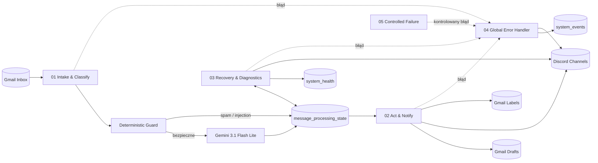

### Podział odpowiedzialności

| Workflow | Odpowiedzialność | Harmonogram / trigger |
|---|---|---|
| 01 | pobranie, deduplikacja, guard, Gemini, zapis klasyfikacji | Gmail Trigger co minutę + manual trigger |
| 02 | draft, routing Discord, alert bezpieczeństwa, etykiety końcowe | co minutę + manual trigger |
| 03 | recovery, safety scan, diagnostyka, raport zdrowia | co 5 min, co 15 min, codziennie 08:15 |
| 04 | globalna obsługa błędów | `Error Trigger` |
| 05 | bezpieczny test automatycznego error flow | manual launcher + webhook `POST` |

---

## 3. Przepływ wiadomości end-to-end

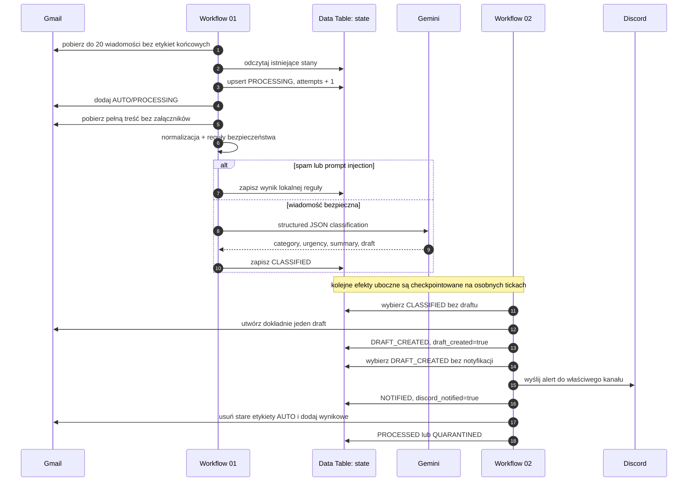

### Dlaczego pełna obsługa trwa do około trzech minut

Workflow 02 celowo wykonuje trzy niezależne grupy workerów, które czytają stan na początku danego execution:

```text
Tick 1: CLASSIFIED   → utworzenie draftu → DRAFT_CREATED
Tick 2: DRAFT_CREATED → Discord          → NOTIFIED
Tick 3: NOTIFIED      → etykiety Gmail    → PROCESSED
```

To jest wzorzec **eventual consistency z trwałymi checkpointami**. Retry Discorda nie powinien ponownie tworzyć draftu, ponieważ `draft_created=true` pozostaje zapisane w Data Table.

---

## 4. Maszyna stanów i idempotencja

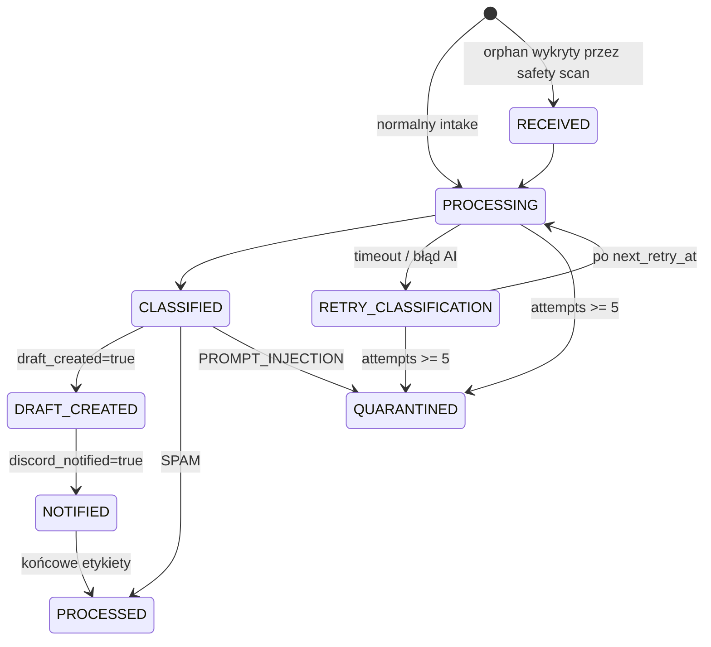

### Klucz idempotencji

`gmail_message_id` jest kluczem biznesowym rekordu. Operacje Data Table używają go jako `matchingColumns` przy `upsert` lub `update`.

### Trwałe checkpointy efektów ubocznych

| Pole | Znaczenie |
|---|---|
| `draft_created` | draft Gmail został już utworzony |
| `discord_notified` | notyfikacja Discord lub alert security został już wysłany |
| `processed_at` | finalizacja etykiet została zakończona |

Status tekstowy opisuje etap procesu, ale przy ochronie przed duplikacją ważniejsze są flagi checkpointów.

---

## 5. Workflow 01 — Intake and Classify

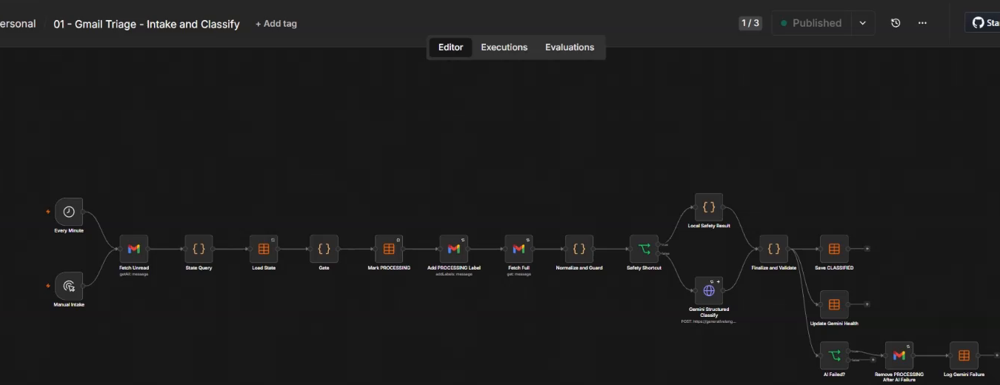

### Cel

Pobranie kandydatów z Gmail, deduplikacja, kontrola bezpieczeństwa, klasyfikacja oraz zapis wyniku w `message_processing_state`.

### Triggery

- `On New Gmail Message` — Gmail Trigger odpytujący skrzynkę co minutę;
- `Manual Intake` — test ręczny.

### Główna ścieżka node po node

| Kolejność | Node | Funkcja |
|---:|---|---|
| 1 | `Fetch Unread` | pobiera maks. 20 wiadomości z Inbox, pomijając przetworzone, przetwarzane i kwarantannę; mimo nazwy używa `readStatus: both` |
| 2 | `State Query` | zapewnia item sterujący także przy pustym wejściu |
| 3 | `Load State` | pobiera wszystkie rekordy `message_processing_state` |
| 4 | `Gate` | deduplikuje, respektuje `next_retry_at`, świeży `PROCESSING` i limit 5 prób |
| 5 | `Mark PROCESSING` | atomowo logicznie rezerwuje wiadomość przez upsert i zwiększa `attempts` |
| 6 | `Add PROCESSING Label` | dodaje etykietę roboczą Gmail |
| 7 | `Fetch Full` | pobiera pełny MIME wiadomości; załączniki nie są pobierane |
| 8 | `Normalize and Guard` | normalizuje body, wykrywa spam, urgency, auth i prompt injection |
| 9 | `Safety Shortcut` | wybiera regułę lokalną albo Gemini |
| 10a | `Local Safety Result` | obsługuje SPAM, PROMPT_INJECTION lub otwarty circuit breaker bez AI |
| 10b | `Gemini Structured Classify` | wywołuje Gemini z wymuszonym JSON Schema |
| 11 | `Finalize and Validate` | waliduje kategorie, confidence, urgency, summary i draft |
| 12 | `Save CLASSIFIED` | zapisuje `CLASSIFIED` albo `RETRY_CLASSIFICATION` |
| 13 | `Update Gemini Health` | aktualizuje zdrowie komponentu Gemini |
| 14 | `AI Failed?` | uruchamia cleanup, zapis `system_events` i natychmiastowy alert `Discord Gemini Failure` |

### Query Gmail

```text
in:inbox
-label:AUTO/Przetworzone
-label:AUTO/Przetwarzanie
-label:AUTO/Kwarantanna
```

Mimo nazwy `Fetch Unread`, node ma `readStatus: both`, więc pobiera wiadomości przeczytane i nieprzeczytane. Spam i kosz są wyłączone. Etykiety są zastępowane identyfikatorami Gmail podczas wdrożenia.

### Gate i kryteria pominięcia

Wiadomość nie jest pobierana do pracy, jeżeli:

- stan to `PROCESSED` lub `QUARANTINED`;
- `next_retry_at` jest w przyszłości;
- stan `PROCESSING` został zaktualizowany mniej niż 10 minut temu;
- `attempts >= 5`.

### Normalizacja treści

`Normalize and Guard`:

- odczytuje nagłówki `From`, `Reply-To`, `Subject`, `Authentication-Results`;
- dekoduje MIME Base64 URL-safe;
- preferuje `text/plain`;
- usuwa `<script>`, `<style>` i HTML;
- odcina typowe cytowane odpowiedzi;
- ogranicza body do 3000 znaków;
- nie pobiera załączników;
- określa SPF/DKIM/DMARC i zaufanie nadawcy;
- wykrywa urgency przez deterministyczne słowa kluczowe;
- wykrywa prompt injection w EN/PL/RU/UK.

### Guard prompt injection

Reguły szukają m.in. prób:

- ignorowania poprzednich instrukcji;
- użycia `system:` lub `developer:` jako instrukcji;
- ujawnienia promptu, `.env`, tokenu, hasła, sekretu lub API key;
- wymuszenia określonego outputu;
- analogicznych sformułowań po polsku, rosyjsku i ukraińsku.

Treść oznaczona jako prompt injection **nie trafia do Gemini**.

### Gemini

- endpoint: `generativelanguage.googleapis.com/v1beta/models/gemini-3.1-flash-lite:generateContent`;
- uwierzytelnienie: credential n8n `googlePalmApi`;
- timeout: 20 sekund;
- `temperature: 0`;
- `maxOutputTokens: 700`;
- odpowiedź: `application/json` z JSON Schema;
- summary i draft muszą być po polsku;
- draft nie może obiecywać terminu, przyznawać odpowiedzialności ani prosić o sekrety.

### Kategorie

```text
OFFER_INQUIRY
EXISTING_CLIENT
COMPLAINT_ESCALATION
BILLING
TECHNICAL_INCIDENT
LEGAL_PRIVACY
PARTNERSHIP_RECRUITMENT
SPAM
OTHER
PROMPT_INJECTION
```

### Walidacja odpowiedzi AI

- nieznana kategoria → `OTHER`;
- confidence ograniczone do przedziału `0..1`;
- final urgency jest maksimum z reguły deterministycznej i wyniku modelu;
- summary ograniczone do 300 znaków;
- draft ograniczony do 3000 znaków;
- linki, mentiony Discord i fenced code są usuwane;
- draft jest zerowany, gdy confidence `< 0.75`, AI zawiedzie lub draft zawiera słowa typu `password`, `token`, `secret`, `api key`.

Model zwraca również `reply_recommended`, ale obecna implementacja nie zapisuje tego pola w Data Table i workflow 02 go nie używa. Pole robocze `manual_review` także nie jest zapisywane; finalna etykieta ręcznej weryfikacji jest wyliczana ponownie na podstawie `confidence < 0.75`.

### Stan przed i po klasyfikacji

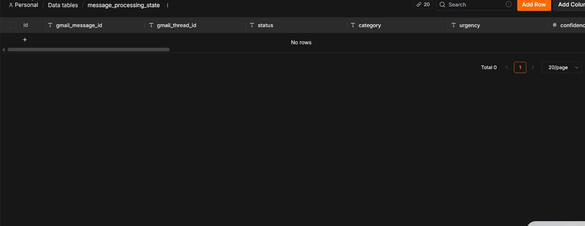

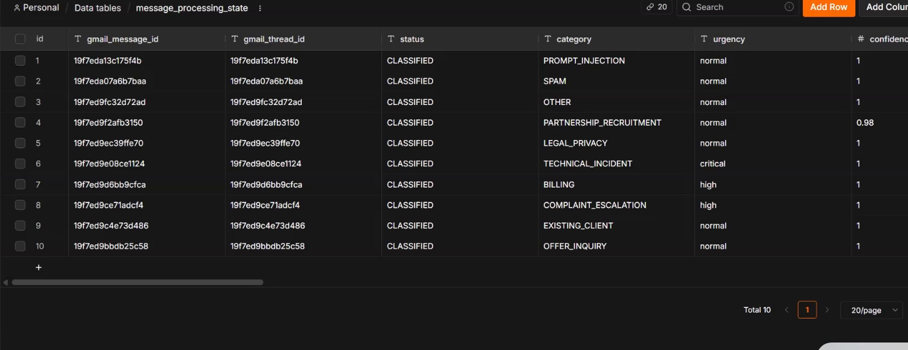

---

## 6. Workflow 02 — Act and Notify

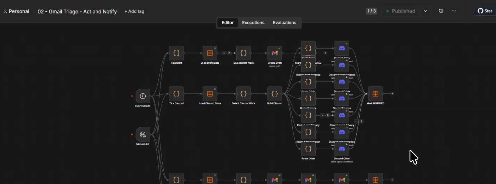

### Cel

Wykonanie efektów ubocznych po klasyfikacji bez ich duplikowania:

1. utworzenie draftu;
2. notyfikacja odpowiedniego zespołu na Discordzie;
3. końcowe etykiety Gmail;
4. osobny metadata-only alert dla prompt injection.

### Triggery

- `Every Minute` — cron `* * * * *`;
- `Manual Act` — ręczny test.

Oba triggery uruchamiają równolegle cztery gałęzie:

```text
Draft worker
Discord worker
Finalize worker
Security worker
```

Każdy worker ponownie odczytuje Data Table i wybiera wyłącznie rekordy spełniające warunki.

### A. Draft worker

```text
Tick Draft
→ Load Draft State
→ Select Draft Work
→ Create Draft
→ Mark DRAFT_CREATED
```

Warunki:

- `status = CLASSIFIED`;
- `draft_created = false`;
- category nie jest `SPAM` ani `PROMPT_INJECTION`;
- maks. 20 rekordów na tick.

Każdy zwykły rekord `CLASSIFIED` spełniający te warunki otrzymuje draft — niezależnie od wartości `reply_recommended` zwróconej przez Gemini.

Draft:

- jest tworzony w istniejącym Gmail thread;
- odbiorcą jest `sender_reply_address`;
- temat ma prefix `Re:`;
- treść jest czyszczona z URL-i, mentionów i fenced code;
- maks. 3000 znaków;
- brak wygenerowanej treści powoduje użycie bezpiecznego fallbacku po polsku;
- na końcu dodawany jest techniczny identyfikator `[triage-id:...]`.

### B. Discord worker

```text
Tick Discord
→ Load Discord State
→ Select Discord Work
→ Build Discord
→ Route <team>
→ Discord <team>
→ Mark NOTIFIED
```

Warunki:

- `draft_created = true`;
- `discord_notified = false`;
- status `DRAFT_CREATED` lub awaryjnie `CLASSIFIED`;
- category nie jest `SPAM` ani `PROMPT_INJECTION`;
- maks. 20 rekordów na tick.

Payload zawiera:

- kategorię po polsku;
- priorytet;
- mention roli właściciela i opcjonalnej roli backup dla `critical`;
- maks. trzy zdania summary;
- propozycję odpowiedzi do 900 znaków;
- link do Gmail thread.

> **Ważne:** Discord nie dostaje surowego body ani adresu nadawcy. Dostaje jednak **AI-generated summary i draft**, które powstały na podstawie body. To nadal może przenieść dane osobowe lub wrażliwe i wymaga oceny organizacyjnej.

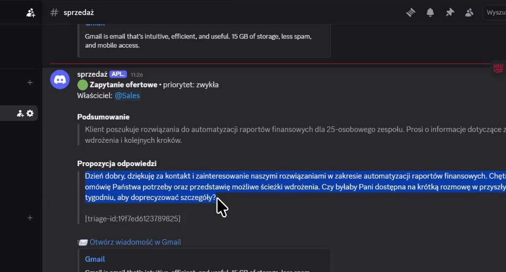

### C. Finalize worker

```text
Tick Finalize
→ Load Finalize State
→ Select Finalize Work
→ Remove Existing AUTO Labels
→ Apply AUTO Labels
→ Remove PROCESSING Label
→ Save Final Status
```

Worker usuwa wszystkie zarządzane etykiety wynikowe przed dodaniem nowego zestawu. Zapobiega to konfliktom po korekcie decyzji.

Finalizowane są:

- `NOTIFIED` i `ESCALATED`;
- `QUARANTINED` bez `processed_at`;
- `CLASSIFIED` dla `SPAM` i `PROMPT_INJECTION`.

Wynik końcowy:

- `PROCESSED` dla normalnego maila i spamu;
- `QUARANTINED` dla prompt injection lub rekordu już skierowanego do kwarantanny.

<div class="page-break"></div>

### D. Security worker

```text
Tick Security
→ Load Security State
→ Select Security Alerts
→ Build Security Alert
→ Discord Security Alert
→ Mark Security Alerted
```

Warunki:

- `status = QUARANTINED`;
- `category = PROMPT_INJECTION`;
- `processed_at` istnieje;
- `discord_notified = false`.

Alert zawiera tylko:

- informację o kwarantannie;
- link techniczny do Gmail thread;
- czas kwarantanny;
- opcjonalny mention administratora.

Nie zawiera sendera, subjectu, body ani AI summary.

---

## 7. Workflow 03 — Recovery and Diagnostics

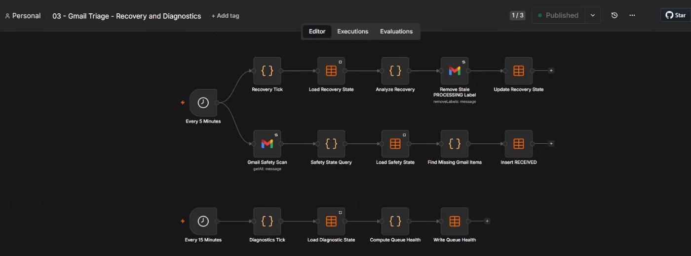

Workflow składa się z trzech niezależnych sekcji.

### A. Recovery — co 5 minut

```text
Every 5 Minutes
→ Recovery Tick
→ Load Recovery State
→ Analyze Recovery
→ Remove Stale PROCESSING Label
→ Update Recovery State
```

Obsługuje stany:

```text
PROCESSING
FETCHING
RECEIVED
RETRY_CLASSIFICATION
```

Jeżeli `PROCESSING`, `FETCHING` lub `RECEIVED` nie zmienił się przez ponad 10 minut:

1. zwiększany jest `attempts`;
2. stan przechodzi do `RETRY_CLASSIFICATION`;
3. wyliczane jest `next_retry_at`;
4. usuwana jest zalegająca etykieta `AUTO/PROCESSING`.

Po pięciu próbach rekord przechodzi do `QUARANTINED` z błędem `maximum classification retry attempts reached`.

### B. Gmail Safety Scan — co 5 minut

Query:

```text
newer_than:1d in:inbox
-label:AUTO/Przetworzone
-label:AUTO/Przetwarzanie
-label:AUTO/Kwarantanna
```

Scan pobiera maks. 50 wiadomości i porównuje je z Data Table. Brakujący mail dostaje stan `RECEIVED`, dzięki czemu następny intake może go przejąć. Jest to safety net, a nie pełna rekonsyliacja historyczna: obejmuje tylko ostatnią dobę i pierwszy batch 50 wyników.

### C. Queue diagnostics — co 15 minut

Wyliczane są:

- `pending` — rekordy poza `PROCESSED` i `QUARANTINED`;
- `stale` — pending starsze niż 10 minut;
- `failedQuarantine` — kwarantanna wynikająca z awarii/retry, a nie polityki prompt injection.

Status kolejki:

| Warunek | Status |
|---|---|
| `stale > 0`, `pending > 20` lub failed quarantine | `CRITICAL` |
| istnieje pending | `DEGRADED` |
| brak pending i stale | `HEALTHY` |

### D. Raport dzienny — 08:15 Europe/Warsaw

`Build Daily Report` czyta `system_health` i oznacza telemetry starszą niż 30 minut jako `UNKNOWN`, niezależnie od zapisanego wcześniej statusu.

Ikony:

- 🟢 `HEALTHY` / ZDROWY;
- 🟠 `DEGRADED` / OGRANICZONY;
- 🔴 `CRITICAL` / KRYTYCZNY;
- ⚪ `UNKNOWN` / NIEZNANY.

---

## 8. Workflow 04 — Global Error Handler

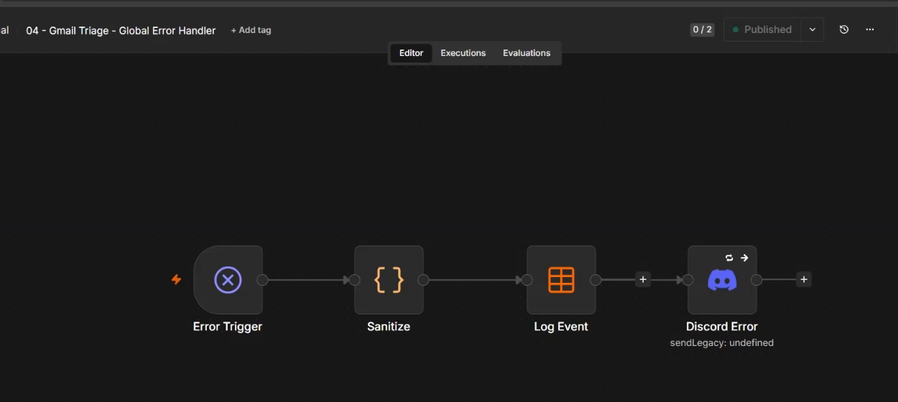

```text
Error Trigger
→ Sanitize
├→ Log Event
└→ Discord Error
```

### Jak jest podłączony

ID workflow 04 jest zapisane w `settings.errorWorkflow` workflow 01, 02, 03 i 05.

### Ważne zachowanie n8n

`Error Trigger` uruchamia się automatycznie tylko po błędzie execution uruchomionego automatycznie, np. schedule lub webhook. **Nie uruchamia się po zwykłym manual execution** — jest to zachowanie n8n, nie błąd workflow.

### Sanityzacja błędu

Node `Sanitize`:

- bierze nazwę workflow i ostatni node;
- zachowuje tylko pierwszą linię błędu;
- zastępuje URL przez `[url]`;
- redaguje wartości po `api key`, `token`, `secret`, `password`;
- redaguje długie tokenopodobne ciągi;
- ogranicza komunikat do 240 znaków;
- ustala severity: `critical`, `warning` lub `error`.

Sanityzacja nie maskuje automatycznie adresów e-mail, ścieżek plików ani dowolnego PII umieszczonego w tekście wyjątku. Workflowy źródłowe nie powinny zatem wkładać subjectu ani body wiadomości do `Error.message`.

### Efekty

- rekord w `system_events`;
- alert na Discord przez credential `Discord - Inne`.

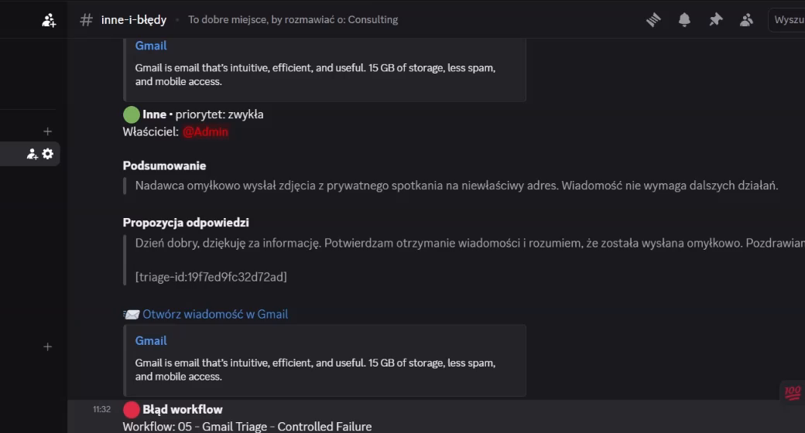

---

## 9. Workflow 05 — Controlled Failure

### Cel

Bezpieczna demonstracja, że automatyczny error flow działa bez uszkadzania workflow produkcyjnych.

### Struktura

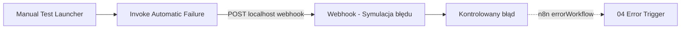

### Dlaczego launcher wywołuje webhook

Bezpośredni błąd po `Manual Trigger` nie uruchomiłby globalnego Error Workflow. Dlatego:

1. użytkownik klika `Execute workflow` w 05;
2. `Invoke Automatic Failure` wykonuje `POST` do produkcyjnego webhooka 05;
3. powstaje osobne execution typu `webhook`;
4. node `Kontrolowany błąd` rzuca kontrolowany wyjątek;
5. n8n automatycznie uruchamia workflow 04 w trybie `error`.

Webhook:

```text
POST http://127.0.0.1:5678/webhook/gmail-triage-controlled-failure
```

> **Ostrzeżenie:** webhook nie ma uwierzytelnienia i celowo zawsze generuje błąd. Workflow 05 powinien być aktywny wyłącznie w kontrolowanym środowisku testowym lub dodatkowo chroniony na warstwie sieciowej. Sam sukces requestu HTTP nie potwierdza obsługi błędu, ponieważ webhook odpowiada `onReceived`; trzeba zweryfikować execution 04, wpis `system_events` i alert Discord.

Zweryfikowana sekwencja live:

```text
05: mode=webhook, status=error
04: mode=error,   status=success
```

---

## 10. Model danych

### 10.1 `message_processing_state`

Główna tabela stanu; jeden logiczny rekord na `gmail_message_id`.

| Kolumna | Typ | Znaczenie |
|---|---|---|
| `gmail_message_id` | string | klucz idempotencji Gmail |
| `gmail_thread_id` | string | thread używany dla draftu i deep linku |
| `status` | string | aktualny etap maszyny stanów |
| `category` | string | wynik klasyfikacji |
| `urgency` | string | `normal`, `high`, `critical` |
| `confidence` | number | confidence modelu w zakresie `0..1` |
| `draft_created` | boolean | trwały checkpoint draftu |
| `discord_notified` | boolean | trwały checkpoint Discord/security alert |
| `attempts` | number | liczba prób przetwarzania |
| `next_retry_at` | date | najwcześniejszy czas kolejnej próby |
| `last_error` | string | ostatni bezpieczny opis błędu |
| `created_at` | date | utworzenie rekordu |
| `updated_at` | date | ostatnia zmiana |
| `processed_at` | date | zakończenie finalizacji |
| `sender_reply_address` | string | adres odbiorcy draftu |
| `subject` | string | subject używany dla draftu |
| `lang` | string | wykryty język (`pl`/`en` w obecnej implementacji) |
| `draft_body` | string | oczyszczona propozycja odpowiedzi |
| `summary` | string | krótkie podsumowanie AI |

### 10.2 `system_health`

| Kolumna | Typ | Znaczenie |
|---|---|---|
| `component` | string | nazwa monitorowanego komponentu |
| `status` | string | `HEALTHY`, `DEGRADED`, `CRITICAL` |
| `consecutive_failures` | number | licznik kolejnych awarii |
| `circuit_state` | string | `CLOSED` lub `OPEN` |
| `last_success_at` | date | ostatni sukces |
| `last_failure_at` | date | ostatnia porażka |
| `last_error` | string | ostatni bezpieczny komunikat |
| `updated_at` | date | aktualizacja telemetry |

### 10.3 `system_events`

| Kolumna | Typ | Znaczenie |
|---|---|---|
| `event_id` | string | unikalny identyfikator zdarzenia |
| `severity` | string | poziom błędu |
| `component` | string | workflow/node/komponent |
| `event_type` | string | np. `workflow_error`, `classification_retry` |
| `message` | string | zsanityzowany komunikat |
| `created_at` | date | utworzenie zdarzenia |
| `resolved_at` | date | opcjonalne zamknięcie incydentu |

---

## 11. Integracje i credentiale

Sekrety są przechowywane wyłącznie w n8n. JSON-y workflow zawierają nazwy credentiali, ale nie ich wartości.

### Gmail

| Typ | Nazwa |
|---|---|
| `gmailOAuth2` | `Gmail - Contact Mailbox` |

Zakres operacji:

- odczyt wiadomości i nagłówków;
- dodawanie/usuwanie etykiet;
- tworzenie draftów;
- brak automatycznego wysyłania odpowiedzi.

### Gemini

| Typ | Nazwa |
|---|---|
| `googlePalmApi` | `Gemini - Mail Triage` |

Klucz API nie jest dodawany do query stringa. HTTP Request używa `predefinedCredentialType`.

### Discord

| Typ | Credential |
|---|---|
| `discordWebhookApi` | `Discord - Sprzedaż` |
| `discordWebhookApi` | `Discord - Obsługa klienta` |
| `discordWebhookApi` | `Discord - Incydenty i eskalacje` |
| `discordWebhookApi` | `Discord - Finanse` |
| `discordWebhookApi` | `Discord - Prawo i prywatność` |
| `discordWebhookApi` | `Discord - Administracja` |
| `discordWebhookApi` | `Discord - Inne` |

To jest stan faktycznie używany przez workflow 02–04. Starszy README wymienia jeden credential triage i osobny automation alert — ten opis jest nieaktualny względem obecnych JSON-ów.

### Role Discord z environment variables

```text
DISCORD_ROLE_SALES
DISCORD_ROLE_CLIENT_SUCCESS
DISCORD_ROLE_CRISIS
DISCORD_ROLE_CRISIS_BACKUP
DISCORD_ROLE_FINANCE
DISCORD_ROLE_LEGAL_PRIVACY
DISCORD_ROLE_ADMIN
```

---

## 12. Etykiety Gmail

Plik mapowania wdrożeniowego przypisuje nazwy logiczne do ID Gmail. ID są zależne od konta i nie powinny być hardcodowane w workflow.

### Etykiety procesu

```text
AUTO/PROCESSING
AUTO/PROCESSED
AUTO/URGENT
AUTO/MANUAL_REVIEW
AUTO/QUARANTINED
AUTO/SPAM
```

### Etykiety kategorii

```text
Kategoria/Zapytanie ofertowe
Kategoria/Obecny klient
Kategoria/Reklamacja i eskalacja
Kategoria/Rozliczenia
Kategoria/Incydent techniczny
Kategoria/Prawo i prywatność
Kategoria/Współpraca i rekrutacja
Kategoria/Inne
Kategoria/Niechciane
```

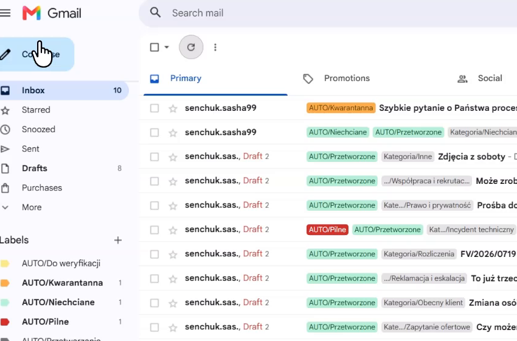

---

## 13. Routing Discord

| Kategoria | Route | Kanał credential | Rola główna |
|---|---|---|---|
| `OFFER_INQUIRY` | `sales` | Sprzedaż | `DISCORD_ROLE_SALES` |
| `EXISTING_CLIENT` | `client_success` | Obsługa klienta | `DISCORD_ROLE_CLIENT_SUCCESS` |
| `COMPLAINT_ESCALATION` | `crisis` | Incydenty i eskalacje | `DISCORD_ROLE_CRISIS` |
| `TECHNICAL_INCIDENT` | `crisis` | Incydenty i eskalacje | `DISCORD_ROLE_CRISIS` |
| `BILLING` | `finance` | Finanse | `DISCORD_ROLE_FINANCE` |
| `LEGAL_PRIVACY` | `legal_privacy` | Prawo i prywatność | `DISCORD_ROLE_LEGAL_PRIVACY` |
| `PARTNERSHIP_RECRUITMENT` | `administration` | Administracja | `DISCORD_ROLE_ADMIN` |
| `OTHER` | `other` | Inne | `DISCORD_ROLE_ADMIN` |
| `SPAM` | brak | brak alertu | — |
| `PROMPT_INJECTION` | security | Inne | administrator |

Dla `urgency=critical` dodawana jest opcjonalna rola `DISCORD_ROLE_CRISIS_BACKUP`.

---

## 14. Bezpieczeństwo i prywatność

### Zastosowane zabezpieczenia

1. **Untrusted input boundary** — body maila jest jawnie opakowane w `<UNTRUSTED_EMAIL>`.
2. **Deterministic guard przed AI** — spam i prompt injection omijają Gemini.
3. **Structured output** — Gemini musi zwrócić JSON zgodny ze schema.
4. **Temperature 0** — zwiększenie powtarzalności klasyfikacji.
5. **Content minimization** — HTML, script/style, cytaty i długie treści są ograniczane.
6. **Brak automatycznej wysyłki maila** — system tworzy tylko draft.
7. **Discord mention sanitization** — usuwane są `@everyone`, `@here` i wstrzyknięte role.
8. **URL sanitization** — linki z model-generated content są zastępowane przez `[link removed]`.
9. **Secret redaction w błędach** — globalny handler usuwa tokeny, hasła, sekrety i URL-e.
10. **Credential isolation** — sekrety pozostają w n8n i plikach lokalnych ignorowanych przez Git.
11. **Metadata-only security alert** — prompt injection nie wysyła treści/sendera/subjectu na Discord.

### Granica prywatności Discord

Normalna notyfikacja zawiera summary i draft. Są one oczyszczone i ograniczone długością, ale model mógł streścić dane osobowe obecne w wiadomości. Jeśli kanały Discord mają szerszy dostęp niż skrzynka kontaktowa, należy wdrożyć dodatkową redakcję PII albo wysyłać wyłącznie kategorię, urgency i link.

---

## 15. Odporność, retry i circuit breaker

### Exponential backoff

Recovery używa kolejnych opóźnień:

```text
1 min → 5 min → 15 min → 30 min → 60 min
```

Limit wynosi 5 prób. Po jego przekroczeniu rekord jest kwarantannowany.

### Stale lock

Stan `PROCESSING` jest traktowany jako świeży przez 10 minut. Po tym czasie recovery może go odzyskać.

### Gemini circuit breaker

W workflow static data przechowywane są:

- `geminiFailures`;
- `geminiOpenUntil`.

Po co najmniej 5 kolejnych awariach circuit otwiera się na 10 minut. W tym czasie `Normalize and Guard` ustawia `_skip_reason = circuit_open`, a wiadomość przechodzi do retry zamiast wykonywać kolejne wywołania Gemini.

### Limity batch

| Operacja | Limit na tick |
|---|---:|
| Gmail intake | 20 |
| Draft work | 20 |
| Discord work | 20 |
| Security alerts | 20 |
| Finalize work | 30 |
| Gmail safety scan | 50 |

---

## 16. Wdrożenie i konfiguracja

### Wymagania

- n8n `2.30.x` (live: `2.30.7`);
- Python 3;
- `pytest` dla walidacji;
- działające Data Tables;
- Gmail OAuth, Gemini credential i webhooki Discord;
- mapa etykiet Gmail;
- ustawione role Discord w środowisku n8n.

### Generowanie workflow

```bash
cd projects/resilient-gmail-triage
python3 src/generate_workflows.py
python3 -m pytest -q
```

### Preflight bez zapisu

```bash
python3 src/deploy.py \
  --api-key-file /ścieżka/do/n8n-api-key \
  --label-map-file /ścieżka/do/label_ids.json
```

Preflight:

1. sprawdza health n8n;
2. rozwiązuje credential ID po dokładnej nazwie i typie;
3. sprawdza istnienie Data Tables, ale nie tworzy ich i nie waliduje kolumn;
4. waliduje mapę labeli;
5. nie importuje i nie aktywuje workflow.

### Import/update

```bash
python3 src/deploy.py \
  --api-key-file /ścieżka/do/n8n-api-key \
  --label-map-file /ścieżka/do/label_ids.json \
  --apply
```

Deployer 01–04:

1. podstawia label ID lokalnie;
2. importuje/aktualizuje 04 jako pierwszy;
3. wpisuje ID 04 do `settings.errorWorkflow` workflow operacyjnych;
4. defensywnie dezaktywuje importowane workflow;
5. weryfikuje, że pozostały nieaktywne.

> **Workflow 05:** obecna wersja deployera nie obejmuje 05. Aktualizacja 05 wymaga osobnego importu/API lub rozszerzenia `WORKFLOW_ORDER`. Nie uruchamiaj pełnego deployera bez zaplanowanej ponownej aktywacji 01–04.

Deployer nie ma transakcji, automatycznego backupu ani rollbacku. Listy credentials i workflow mają stałe limity bez paginacji, a upsert po nazwie nie wykrywa duplikatów workflow o tej samej nazwie. Przed `--apply` należy wyeksportować aktualny stan n8n.

### Aktywacja po imporcie

Po testach aktywuj w kolejności:

```text
04 Global Error Handler
01 Intake and Classify
02 Act and Notify
03 Recovery and Diagnostics
05 Controlled Failure (tylko jeśli ma być dostępny test webhookowy)
```

---

## 17. Testy i procedura akceptacyjna

### Automatyczny test suite

Zweryfikowany wynik:

```text
78 passed in 2.39s
```

Testy obejmują m.in.:

- strukturę i połączenia workflow;
- brak sekretów/hardcoded webhooków;
- expected credentials i Data Tables;
- placeholdery etykiet;
- logikę state machine;
- stress fixture generator i sender;
- audit stress run;
- controlled failure i manual launcher;
- język polski materiałów demo.

### Minimalny test UI jednego maila

1. Wyślij unikalny syntetyczny mail.
2. Poczekaj na workflow 01 lub uruchom `Manual Intake`.
3. Sprawdź `CLASSIFIED` w `message_processing_state`.
4. Uruchom `Manual Act` trzy razy albo poczekaj na kolejne minute ticks.
5. Oczekuj kolejno:
   - `DRAFT_CREATED` i dokładnie jeden draft;
   - `NOTIFIED` i dokładnie jeden Discord alert;
   - `PROCESSED` oraz końcowe etykiety Gmail.
6. Potwierdź, że nie powstał drugi draft ani drugi alert.

### Test error handling

1. Otwórz workflow 05.
2. Kliknij `Execute workflow` na `Manual Test Launcher`.
3. Launcher wywoła webhook automatyczny.
4. Oczekuj:
   - 05: execution `mode=webhook`, `status=error`;
   - 04: execution `mode=error`, `status=success`;
   - jeden nowy rekord `system_events`;
   - jeden alert Discord.

Nie klikaj ręcznie `Execute workflow` na samym workflow 04 jako testu automatyzacji — utworzy to tylko execution `manual`.

---

## 18. Monitoring i utrzymanie

### Codziennie / automatycznie

- sprawdzaj dzienny raport zdrowia;
- `UNKNOWN` oznacza starą telemetry, nie sukces;
- `DEGRADED` oznacza oczekującą kolejkę lub kwarantannę;
- `CRITICAL` oznacza stale item, przekroczony próg kolejki lub quarantine po awarii.

### Przy incydencie

1. sprawdź `system_events`;
2. otwórz wskazany workflow i ostatni node;
3. sprawdź `message_processing_state.last_error`;
4. nie zeruj `draft_created` ani `discord_notified` bez sprawdzenia Gmail/Discord;
5. jeżeli rekord jest stale, pozwól workflow 03 wykonać bounded recovery;
6. dopiero po analizie ręcznie zmieniaj stan.

### Backup

Należy backupować:

- bazę n8n / wolumen Docker;
- credential store n8n zgodnie z polityką organizacji;
- repozytorium JSON-ów workflow;
- lokalny, niecommitowany label map;
- konfigurację environment variables ról Discord.

### Tunel Lapatron

UI n8n jest dostępne na Lapatronie przez tunel SSH pod:

```text
http://127.0.0.1:5678
```

Brak odpowiedzi pod tym adresem nie musi oznaczać awarii n8n. Najpierw sprawdź:

1. health n8n na hoście;
2. listener `127.0.0.1:5678` na Lapatronie;
3. proces/tunel SSH.

---

## 19. Znane ograniczenia

### 1. Summary i draft na Discordzie

Normalny alert Discord zawiera treść pochodną od maila. To ogranicza surowe dane, ale nie gwarantuje pełnej anonimizacji PII.

**Rekomendacja:** dodać deterministyczny PII redactor lub tryb `metadata-only` dla kategorii `LEGAL_PRIVACY`, `BILLING` i `COMPLAINT_ESCALATION`.

### 2. Deduplikacja przy równoległych executions

`Gate` odczytuje tabelę, a dopiero potem wykonuje upsert. Przy dwóch idealnie równoczesnych execution istnieje teoretyczne okno race condition, jeśli Data Table nie wymusza unikalności `gmail_message_id`.

**Rekomendacja:** wymusić serial execution/concurrency 1 dla workflow 01 albo unikalny constraint poza n8n Data Table, jeżeli backend na to pozwala.

### 3. Wykrywanie języka

Obecna implementacja rozróżnia głównie `pl` i `en` przez obecność polskich znaków. Nie jest to pełny language detector.

**Rekomendacja:** użyć deterministycznej biblioteki language detection lub zwracać język w schemacie Gemini z walidacją.

### 4. Discord webhook po sukcesie, checkpoint po wysyłce

Jeżeli Discord przyjmie wiadomość, ale zapis `Mark NOTIFIED` zawiedzie, retry może wysłać duplikat.

**Rekomendacja:** użyć idempotency store/outbox pattern, ewentualnie zapisywać planned event przed wysyłką i reconcylować po message ID Discord.

### 5. Draft po sukcesie, checkpoint po utworzeniu

Analogiczne małe okno istnieje między `Create Draft` a `Mark DRAFT_CREATED`.

**Rekomendacja:** przed tworzeniem draftu wyszukiwać `[triage-id:<gmail_message_id>]` i reconcylować istniejący draft.

### 6. Workflow 05 poza standardowym deployerem

Plik istnieje i jest wdrożony, ale `src/deploy.py` zarządza standardowo tylko 01–04.

**Rekomendacja:** dodać 05 do osobnej komendy `--include-controlled-failure`, domyślnie wyłączonej.

### 7. Pełne skany Data Table

Workflow 01 odczytuje całą `message_processing_state` raz na tick, a workflow 02 robi cztery pełne odczyty co minutę. Limity 20/30 są stosowane dopiero po załadowaniu całej tabeli.

**Rekomendacja:** filtrować rekordy po statusie i checkpointach na poziomie Data Table oraz wprowadzić retencję/archiwizację terminalnych rekordów.

### 8. Ograniczone pokrycie modeli testowych

`src/state_machine.py` jest modelem koncepcyjnym i nie odwzorowuje JSON-ów 1:1 — używa m.in. `RETRY` zamiast `RETRY_CLASSIFICATION` i nie uwzględnia `FETCHING`. Test controlled failure sprawdza strukturę, lecz nie wykonuje live webhooka.

**Rekomendacja:** dodać testy integracyjne wykonujące kod JS wybranych node’ów oraz opcjonalny live smoke test workflow 05 z weryfikacją `system_events`.

### 9. Brak walidacji adresu Reply-To

`sender_reply_address` pochodzi z `Reply-To` lub `From` i jest przekazywany do `Create Draft` bez własnej deterministycznej walidacji adresu.

**Rekomendacja:** sparsować mailbox bez display name, odrzucać CR/LF i nietypowe schematy oraz kierować błędny adres do manual review.

---

## 20. Mapa plików

```text
resilient-gmail-triage/
├── README.md
├── DOKUMENTACJA_TECHNICZNA_PL.md
├── workflows/
│   ├── 01_intake_classify.json
│   ├── 02_act_notify.json
│   ├── 03_recovery_diagnostics.json
│   ├── 04_error_handler.json
│   └── 05_controlled_failure.json
├── src/
│   ├── generate_workflows.py
│   ├── deploy.py
│   ├── state_machine.py
│   ├── generate_stress_fixtures.py
│   ├── send_stress_batch.py
│   ├── collect_stress_audit.py
│   └── audit_stress_run.py
├── tests/
│   ├── test_workflows.py
│   ├── test_state_machine.py
│   ├── test_deploy.py
│   ├── test_controlled_failure.py
│   ├── test_stress_fixtures.py
│   ├── test_stress_sender.py
│   ├── test_stress_audit.py
│   └── test_demo_language.py
└── docs/
    ├── ARCHITECTURE.md
    ├── UI_ACCEPTANCE_PL.md
    └── assets/technical/
        ├── 01-intake-classify.png
        ├── 02-state-empty.png
        ├── 03-state-classified.png
        ├── 04-act-notify.png
        ├── 05-discord-result.png
        ├── 06-recovery-diagnostics.png
        ├── 07-gmail-labels.png
        ├── 08-global-error-handler.png
        └── 09-discord-error-alert.png
```

---

## Szybkie podsumowanie operacyjne

```text
Nowy mail
→ 01 klasyfikuje
→ Data Table zapisuje CLASSIFIED
→ 02 tworzy draft
→ 02 wysyła Discord
→ 02 finalizuje etykiety
→ 03 odzyskuje stale/orphan i raportuje zdrowie
→ 04 obsługuje automatyczne błędy
→ 05 pozwala bezpiecznie przetestować 04
```

Najważniejsze zasady:

- nie wysyłaj draftów automatycznie;
- nie resetuj checkpointów bez reconciliation;
- nie testuj Error Trigger przez manualne uruchomienie 04;
- nie commituj API keys, OAuth tokens, webhook URLs ani label IDs;
- traktuj summary/draft na Discordzie jako dane potencjalnie wrażliwe;
- po imporcie wykonaj jeden pełny syntetyczny test przed aktywacją.
